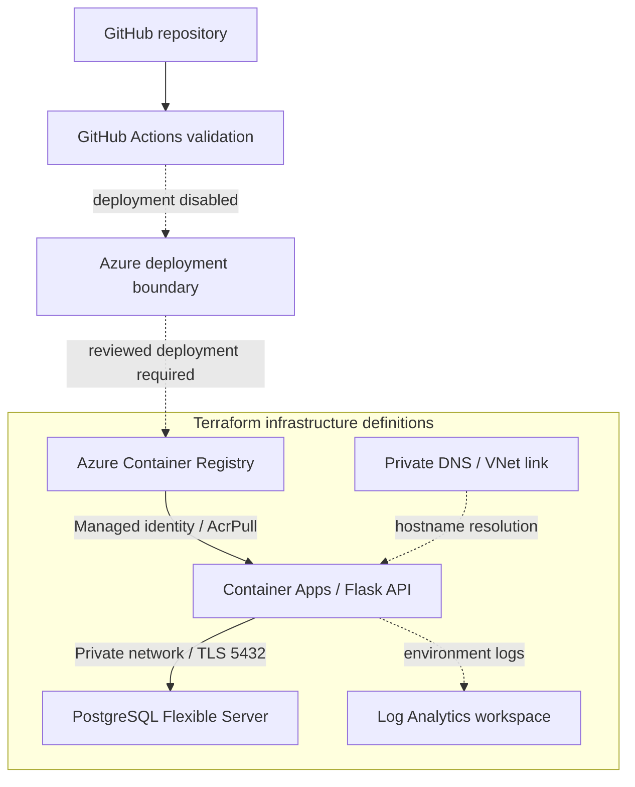
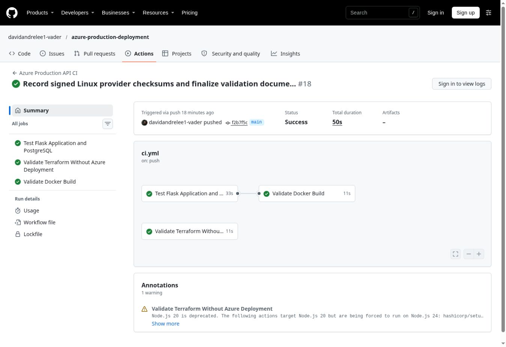

# Azure Cloud Engineering Portfolio

**Terraform · Azure Container Apps · Docker · PostgreSQL · GitHub Actions**

[](https://github.com/davidandrelee1-vader/azure-production-deployment/actions/workflows/ci.yml)

A cloud engineering and DevOps project that packages a Flask API in Docker, defines its Azure infrastructure with Terraform, and validates the application, database integration, image build, and infrastructure configuration through GitHub Actions.

**Verified milestone:** All six application/database tests, Docker build, and Terraform validation passed in [CI run #18](https://github.com/davidandrelee1-vader/azure-production-deployment/actions/runs/41900513523). Repository implementation and documentation are complete for this milestone. Live Azure deployment and private database connectivity have not been independently verified. Automated paid deployment remains disabled.

## Architecture



The diagram describes the configured design. Terraform defines a VNet with separate delegated subnets for Container Apps and PostgreSQL, private database DNS, and an NSG rule allowing application traffic to PostgreSQL on port 5432. Default VNet NSG rules remain, so the explicit allow rule is not exclusive isolation.

## What this project demonstrates

| Area | Implementation |
|---|---|
| Infrastructure as code | Separate Terraform files for networking, identity, registry, application, PostgreSQL, monitoring and outputs |
| Container delivery | Non-root Python container running Gunicorn with two workers on port 5000 |
| Identity and access | User-assigned managed identity with AcrPull for registry access |
| Private database design | PostgreSQL 16 Flexible Server, delegated subnet, public access disabled and VNet-linked private DNS |
| Database transport | `PGSSLMODE=verify-full` and the container CA bundle configured for Azure connections |
| Monitoring | Log Analytics workspace with 30-day retention connected to the Container Apps environment |
| CI | PostgreSQL service, migrations, six pytest tests, Docker build and credential-free Terraform validation |
| Deployment control | Manual preparation workflow; Azure deploy job is unconditionally disabled |
| State management | Existing Azure Storage backend configured separately from application infrastructure |

## Verification evidence



Screenshot: [run #18](https://github.com/davidandrelee1-vader/azure-production-deployment/actions/runs/41900513523), commit `f2b7f5c`, November 4, 2026. This is CI evidence, not proof of live Azure resources. The badge above tracks subsequent runs.

| Check | Verified result |
|---|---|
| Flask endpoint and input validation tests | Passed |
| PostgreSQL connectivity and transaction integration tests | Passed against temporary CI PostgreSQL 16 |
| Versioned SQL migrations | Applied before CI tests |
| Docker image build | Passed |
| Terraform monitoring-file formatting and full configuration validation | Passed with remote backend disabled |
| GitHub Actions syntax | Passed actionlint in [run 41900160120](https://github.com/davidandrelee1-vader/azure-production-deployment/actions/runs/41900160120) |
| Live Azure image pull, private DNS/TLS and API-to-database connectivity | Requires Azure runtime verification |
| Live log ingestion | Requires Azure runtime verification |

Terraform validation checks provider schemas and resource references. It does not verify Azure permissions, quotas, resource availability or network reachability.

## Application endpoints

| Method | Endpoint | Purpose |
|---|---|---|
| GET | `/` | Application information |
| GET | `/health` | Application process health |
| GET | `/db-health` | Database connection check; 503 on connection failure |
| POST | `/transactions` | Validate and store a sample transaction |
| GET | `/transactions` | Retrieve recent transactions |

`/health` can succeed while `/db-health` fails. This distinction helps separate application availability from database connectivity problems. ACA probes are not currently configured in Terraform.

## CI and deployment behavior

Pushes and pull requests to `main` run the application/database tests and Docker build. An independent Terraform job runs formatting checks, initializes with `-backend=false -lockfile=readonly`, and validates the full configuration without Azure credentials. CI does not push an image to ACR or provision Azure resources.

The manual `azure-deploy.yml` workflow prepares an image with its default input. Its deploy job has `if: ${{ false }}`. Setting its input to true does not enable deployment. The separate manual OIDC test only authenticates and displays account information.

The Container App expects `azure-production-api:1.0` in ACR. CI builds a runner-local image, while Compose uses the local tag `2.0`; neither automatically publishes the Azure tag. A new registry must be provisioned before an image can be pushed, so the first Azure rollout needs a reviewed sequence rather than an assumed single apply.

## Local development

Requirements: Docker with Compose. Create an ignored `.env` file containing a strong local `POSTGRES_PASSWORD`, then start the stack:

```bash
docker compose up -d --build
```

The API is bound to `127.0.0.1:5001` and PostgreSQL to `127.0.0.1:5432`. Apply migrations from the project root:

```bash
docker compose run --rm --no-deps -v "${PWD}/database:/database:ro" -w /database --entrypoint python api migrate.py
```

Check `http://localhost:5001/health` and `http://localhost:5001/db-health`. Stop with `docker compose down`; the named database volume persists. Adding `-v` deletes that local data. Integration tests are restricted to `testdb`; CI creates that disposable database separately.

## Repository guide

| Path | Contents |
|---|---|
| `terraform/` | Azure infrastructure and remote backend configuration |
| `app/` | Flask workload, Dockerfile and tests |
| `database/` | Migration runner and versioned SQL |
| `.github/workflows/` | CI, workflow linting, manual preparation and OIDC test |
| `docker-compose.yml` | Local API and PostgreSQL stack |
| [Architecture](docs/ARCHITECTURE.md) | Resource boundaries, traffic, identity and logging |
| [CI/CD](docs/CI_CD.md) | Triggers, permissions and deployment safeguards |
| [Operations](docs/OPERATIONS.md) | Troubleshooting and Log Analytics queries |
| [Deployment handoff](docs/DEPLOYMENT_HANDOFF.md) | Azure rollout, validation and cleanup sequence |

## Operational limits

- PostgreSQL, ACR, logs and state storage can incur charges independently of application traffic. No paid resources are created by CI.
- Secrets, `.env`, variable values and Terraform state belong outside Git. Sensitive Terraform values may still exist in remote state, which needs restricted access.
- The workload currently uses PostgreSQL administrator credentials through a Container App secret. A least-privilege database user remains a production prerequisite.
- Monitoring covers environment logs. Metric alerts, notification action groups, dashboards and application tracing are future improvements.
- Live Azure verification should cover revision health, image pull, private DNS/TLS, database migrations, API operations and log ingestion. Screenshots should show results without credentials or private account details.

## Portfolio summary

Built an Azure cloud engineering portfolio project using Terraform, Container Apps, Container Registry, private PostgreSQL networking and managed identity. Implemented GitHub Actions checks for application/database tests, Docker builds and Terraform validation, and configured Log Analytics with documented deployment and operations procedures.
