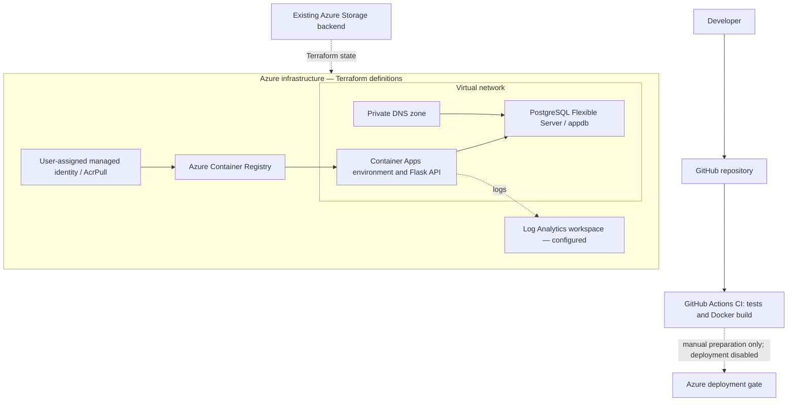

# Azure Cloud Engineering & DevOps — Terraform, Container Apps and CI/CD


**Status:** Infrastructure definitions and CI are prepared; full Azure deployment **not yet verified**. Azure deployment workflow remains disabled. This repository is a portfolio project, not a live-production-service claim.

## Project goal

Demonstrate cloud engineering with Azure networking, infrastructure as code, managed identity, container delivery, monitoring configuration, and automated CI. Flask is a sample workload, not the primary focus.

## Architecture



This diagram describes the intended Azure configuration, not proof of deployed resources.

**Deployment prerequisites:** Build and push the application image to ACR; review Terraform plan and costs; confirm Azure permissions, private networking and database readiness. CI currently builds images but **does not push to ACR**.

## Implemented and verified

| Area | Status |
|---|---|
| Terraform resources: RG, VNet, delegated subnets, NSG, private DNS, ACR, ACA, identity/RBAC, PostgreSQL | Defined in repository |
| Terraform fmt/validate | Changed files pass fmt; provider validation awaits GitHub CI (local provider socket blocked) |
| GitHub Actions CI | Existing tests and Docker build passed [run 41895884095](https://github.com/davidandrelee1-vader/azure-production-deployment/actions/runs/41895884095); added Terraform CI awaits publication |
| Docker build | Previously reported local build |
| Gunicorn startup | Previously reported locally, two workers on port 5000 |
| `/health` | Previously reported HTTP 200 locally |
| `/db-health` without DB | Previously reported HTTP 503 locally (expected) |
| PostgreSQL Azure connectivity | Not tested |
| Cloud image pull and Azure end-to-end deployment | Not tested |
| Azure monitoring | Log Analytics configured in Terraform; not deployed |

## Cloud engineering highlights

- **Networking:** Separate delegated subnets for Container Apps and PostgreSQL; private PostgreSQL DNS and network security rule.
- **Identity:** User-assigned managed identity and role-based ACR pull permission.
- **Infrastructure as Code:** AzureRM Terraform resources with an existing remote Azure Storage state backend.
- **Container operations:** Docker image, non-root runtime user, Gunicorn and health endpoint.
- **CI/CD:** GitHub Actions automated tests and Docker build; deployment is deliberately blocked.
- **Database connectivity:** PostgreSQL connection settings use `PGSSLMODE=verify-full` and a CA bundle path, but no live Azure TLS handshake has been verified.

## Repository map

- `terraform/`: Infrastructure definitions and remote backend.
- `app/`: Sample Flask API and Dockerfile.
- `database/`: Sample migrations.
- `.github/workflows/ci.yml`: Automated tests and image build.
- `.github/workflows/azure-deploy.yml`: Manual preparation only; `deploy` job has `if: false`.
- `docs/`: Architecture, verification, and operations documentation.

## Architecture and delivery documentation

- [Architecture](docs/ARCHITECTURE.md): traffic, private networking, identity and logging.
- [CI/CD](docs/CI_CD.md): triggers, checks, permissions and deployment safeguards.
- [Operations](docs/OPERATIONS.md): runtime troubleshooting and log queries.

## Safe local checks

```powershell
terraform -chdir=terraform fmt -check
terraform -chdir=terraform validate
docker build -t azure-production-api:local ./app
```

These do not provision Azure infrastructure. Running `terraform plan` against the remote backend can still require Azure credentials and access. Do **not** run `terraform apply` without reviewing cost and resource changes.

## Deployment handoff

See [docs/DEPLOYMENT_HANDOFF.md](docs/DEPLOYMENT_HANDOFF.md) for the limited steps requiring Azure access and cost approval. The deployment workflow is **not enabled** in this package.

## Security and cost notes

- Azure PostgreSQL, Container Apps, ACR, Log Analytics, and state storage can incur costs, even when application replicas scale to zero.
- Keep `.env`, `.tfvars`, Terraform state and credentials out of Git.
- PostgreSQL administrator credentials are currently passed as a Container App secret. A least-privilege application database account is recommended before real production use.
- Azure state storage persists separately from the application environment.
- A successful `terraform validate` is not evidence of successful deployment.

## Application endpoints

| Endpoint | Method | Purpose |
|---|---|---|
| `/` | GET | Application information |
| `/health` | GET | Process health, independent of PostgreSQL |
| `/db-health` | GET | Database connection check; returns 503 on failure |
| `/transactions` | GET / POST | Read or create sample transactions |

CI uses a temporary PostgreSQL 16 service and runs the versioned migrations before all six tests. Local development remains available through `docker-compose.yml`; credentials belong in an ignored `.env` file.

## Verification of this update

Formatting of the changed Terraform files, documentation links, and the disabled deployment guard were checked locally. Provider initialization completed with AzureRM 4.81.0; the lockfile adds its Linux package hash without changing the provider version. Local validation could not complete because this execution environment blocks the provider Unix socket. The added CI validation must pass after publication. The badge and linked successful run currently describe the prior published commit.

## Resume-ready description

**Azure Cloud Engineering & DevOps Portfolio Project:** Authored Terraform infrastructure for Azure Container Apps, Container Registry, isolated networking, private PostgreSQL, and managed identity/RBAC. Implemented GitHub Actions CI with tests and Docker build validation; verified local container health and maintained safeguards preventing unapproved Azure deployment.
