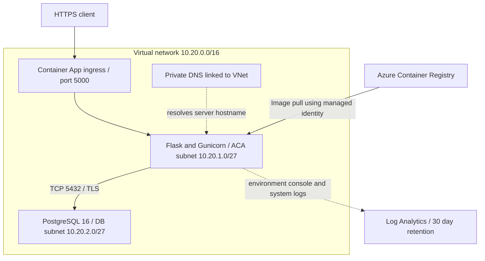

# Architecture

This documents the existing Terraform definitions plus the prepared monitoring configuration. Azure runtime connectivity and end-to-end deployment remain unverified.

## Resource boundaries

| Concern | Definition | Behavior |
|---|---|---|
| Environment | `resource-groups.tf`, `variables.tf` | Development resource group in eastus2 by default |
| Network | `network.tf` | Separate subnets delegated to Container Apps and PostgreSQL |
| Database access | `postgresql.tf`, `private-dns.tf` | Public database access disabled; VNet-linked private DNS |
| NSG | `network.tf` | Explicit ACA-to-DB allow on TCP 5432; default VNet rules still exist, so this is not exclusive isolation |
| Image access | `identity.tf`, `container-registry.tf` | User-assigned identity with AcrPull; ACR admin access disabled |
| Runtime | `container-app.tf` | Single revision, zero-to-one replicas, external ingress to port 5000 |
| Logs | `monitoring.tf`, `container-apps.tf` | PerGB2018 Log Analytics workspace connected to the environment |
| State | `backend.tf` | Existing Azure Storage backend; managed separately from application resources |

The Container App expects `azure-production-api:1.0` in ACR. CI builds an image locally on the runner and does not publish it. Provisioning the registry, publishing the image and deploying the application require a reviewed staged rollout.

## Configuration and operations

PostgreSQL settings reach the application through environment variables; the password is referenced through a Container App secret. TLS uses `verify-full` with the container CA bundle. Administrator credentials are currently reused by the workload; a separate least-privilege database account remains a production prerequisite. Sensitive Terraform values can still be present in remote state and require restricted backend access.

`/health` checks application availability. `/db-health` checks database connectivity; a 503 identifies a dependency failure and is not proof that Gunicorn is down. Neither endpoint is currently configured as an ACA probe in Terraform.

The workspace collects Container Apps environment logs. Metric alerts, notification action groups, dashboards and application tracing are not configured. Retention is 30 days; ingestion and retention can incur charges. The monitoring change may alter existing environment configuration and requires plan review before any future apply.
